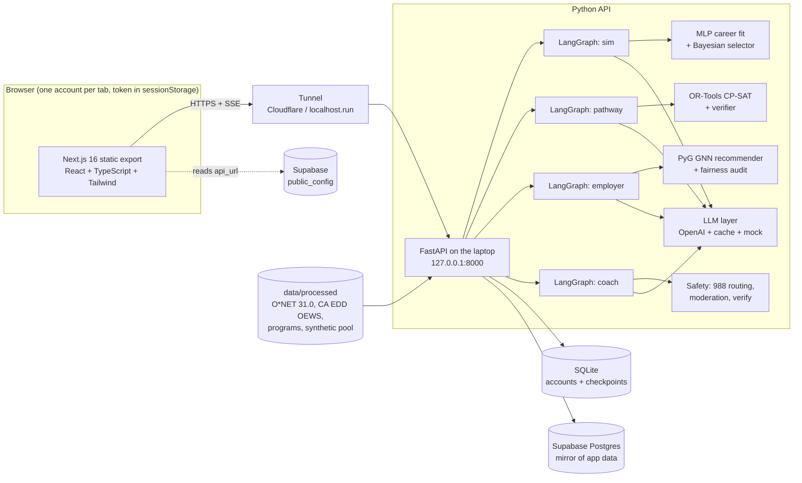

# Foothold

**Try the job. Prove the skill. Get the foothold.**

Foothold is a career app for young people in California's Central Valley (the San Joaquin Valley). A learner plays a short, realistic workday in a career (Diesel Mechanic, Registered Nurse, Logistics Lead and five more) alongside three AI coworkers. Foothold reads the choices they make as evidence of the 21 O*NET 31.0 work styles, suggests careers that fit, and then plans a real route to one of them. That route uses local programs, costs and wages, and a constraint solver that respects their hours, budget and commute. Employers see only blind, skills-only cards and have to ask for consent before anyone's name is shown. Learners also get peer support circles and a coach that sends crisis messages straight to 988. Every number on screen carries a provenance label (REAL, SAMPLE, SYNTHETIC or FICTIONAL), and every person and employer in the demo is fictional.

## The live flow

1. **Sim** (`/sim`, learner): choose a career or let Foothold choose. Each workday moment is picked by an adaptive selector (Bayesian expected information gain). You answer with keys 1, 2 or 3, and three fictional coworkers react in parallel. A "crunch" event tests you under pressure. The report shows a 21-trait radar, your top careers from the trained MLP and the local wage with source badges.
2. **Path** (`/path`, learner): set constraints (hours per week, budget, commute, dependents) or type them in plain English. An LLM turns the text into rules, you confirm them, and an OR-Tools CP-SAT solver plans every route (certificate, apprenticeship, transfer...) in milliseconds, with a greedy baseline shown beside it. Rejecting a plan turns your reason into a new rule. Approving one puts the steps on your board.
3. **Employers** (`/employers`, employer): paste a posting (or click **Fill a sample posting**). The agent extracts a skills profile, searches the blind talent pool, runs a four-fifths fairness check and waits for the employer to pick who to contact.
4. **Inbox** (`/inbox`, learner): the consent request shows up in the learner's tab without a reload. **Accept and share** unlocks that one card for that one employer. **Decline** keeps it hidden.
5. **Circle** (`/circle`, learner): peer support circles, a listening coach and EQ practice scenarios. Crisis language skips the LLM and shows the verified 988 Lifeline message.
6. **Graph** (`/graph`) shows the heterogeneous skills graph and GNN recommendations with explanation paths. **Lab** (`/lab`) shows every model's metrics and data provenance. **About** (`/about`) lists sources and credits.

## Architecture



You can see each graph's nodes in [docs/ARCHITECTURE.md](docs/ARCHITECTURE.md). The images are in `docs/images/langgraph-*.png`.

## Setup

**Python API** (Python 3.12):

```bash
python -m venv ~/.venvs/foothold            # any path; point FOOTHOLD_PY at its python
~/.venvs/foothold/Scripts/python -m pip install -r api/requirements.txt     # (bin/python on macOS/Linux)
~/.venvs/foothold/Scripts/python -m pip install torch --index-url https://download.pytorch.org/whl/cpu
~/.venvs/foothold/Scripts/python -m pip install torch_geometric scikit-learn networkx   # used by the recommender and graph routes
```

`api/requirements.txt` does not list `torch_geometric`, `scikit-learn` or `networkx` yet, so install them as shown above. The versions we tested with are torch 2.14.1+cpu, torch-geometric 2.8.1, scikit-learn 1.9.1, networkx 3.7, langgraph 1.2.17, ortools 9.15 and fastapi 0.162.

**Web** (Node 20+):

```bash
cd web && npm install
```

Registry note: `web/.npmrc` points npm at `https://registry.yarnpkg.com`, a mirror of the npm registry, because the network we built on blocks `registry.npmjs.org`. On an open network you can delete that line.

## Environment variables

Copy `.env.example` to `.env` and fill it in. Never commit `.env`.

| Variable | Purpose |
|---|---|
| `OPENAI_API_KEY`, `OPENAI_MODEL`, `OPENAI_FALLBACK_MODEL`, `OPENAI_REASONING_EFFORT` | LLM calls (we used `gpt-6-luna`, fallback `gpt-5.6-luna`, effort `low`) |
| `LLM_MODE` | `auto` (OpenAI if the key works, else the deterministic mock), `openai` or `mock` |
| `DEMO_MODE` | `1` = serve only cached LLM responses (the golden path works offline) |
| `AUTH_SECRET` | signs per-tab session tokens |
| `SUPABASE_URL`, `SUPABASE_PUBLISHABLE_KEY`, `SUPABASE_SECRET_KEY`, `DB_BACKEND` | optional Postgres mirror (`auto`, `supabase` or `sqlite`) |
| `NEXT_PUBLIC_API_URL` | API URL baked into the web build |
| `FOOTHOLD_PY` | path to the venv's Python, used by `scripts/*.sh` |
| `COLLEGE_SCORECARD_API_KEY` | optional; `DEMO_KEY` is used otherwise |
| `FOOTHOLD_ALLOWED_HOSTS` | extra Host names for LAN demos |

## Run

```bash
scripts/dev.sh        # API on :8000 (uvicorn --reload) + web on :3000; logs in .logs/
scripts/reset.sh      # wipe api/.runtime (accounts db + LangGraph checkpoints) and re-seed; stop the API first
```

API docs: http://localhost:8000/docs. Health check: http://localhost:8000/health.

## Demo accounts (all fictional)

| Account | Kind | Email | Password |
|---|---|---|---|
| Maya Ortiz | learner | maya.ortiz@example.com | valley-maya-01 |
| Dev Sandhu | learner | dev.sandhu@example.com | valley-dev-02 |
| Luis Navarro | learner | luis.navarro@example.com | valley-luis-03 |
| Tri-Valley Freight | employer | hiring@trivalleyfreight.example.org | valley-freight-04 |

Each browser tab keeps its own session in `sessionStorage`, so you can sign a different account into each tab. The unlinked presenter page `/demo` lists the run of show.

## Deployment

Netlify can only serve static files, so the public demo has three parts (full steps in [docs/DEPLOY.md](docs/DEPLOY.md)):

- **Netlify** serves the static Next.js export (`scripts/build_web_static.sh <api-url>` writes the export to `web/out`).
- **The laptop** runs the Python API (FastAPI + LangGraph + PyTorch + OR-Tools) and exposes it through an HTTPS tunnel (`scripts/tunnel.sh`, Cloudflare quick tunnel or `TUNNEL_PROVIDER=ssh` for localhost.run). The API's current public URL is stored in Supabase `public_config.api_url`.
- **Supabase Postgres** mirrors app data (consent requests, postings, circle posts, progress, board). If it isn't configured, everything falls back to local SQLite.

The AI features only work while the laptop, the API and the tunnel are all running.

## What is real and what is not

| Label | What it covers |
|---|---|
| **REAL** | O*NET 31.0 work styles and skills for 42 occupations (CC BY 4.0), CA EDD OEWS 2026 Q1 wages (Stockton-Lodi MSA, with labelled fallbacks), CA EDD projections, Delta College fees, CSU/UC fee pages, the SJETI apprenticeship, 60 verified course listings, the PPIC and California Competes statistics and the 988 Lifeline text. Retrieved 2026-10-24; see [data/SOURCES.md](data/SOURCES.md). |
| **SAMPLE** | Program schedules (sections, times, weekly hours), 15 unverified course listings, Foothold's job-specific skill taxonomy. These are plausible but not verified, and each links to the page to check. |
| **SYNTHETIC** | Every training and evaluation set: 2,000 learners and a talent pool of 150 for the recommender, noisy profiles for career fit, simulated players for the selector, constraint sets for the planner, adversarial claims for the verifier. Also the sim workday events (LLM-drafted, marked DRAFT, need human review). |
| **FICTIONAL** | Maya, Dev, Luis, Tri-Valley Freight, the sim coworkers, the employers and the support circles. |

## Models and how to reproduce them

All results are in [`ml/artifacts/metrics.json`](ml/artifacts/metrics.json). Every number was measured on synthetic data. None of them describe real people.

| Model | Result (from metrics.json) | Reproduce |
|---|---|---|
| Career fit: MLP 21-64-64-42 vs cosine baseline | top-1 0.7133 vs 0.7033, top-3 0.9196 vs 0.9038 over 42 occupations (n = 8,400). On the 8 Foothold careers: top-1 0.9344 vs 0.9225. The MLP wins, by about one point. | `$FOOTHOLD_PY ml/train_career_fit.py` |
| Adaptive selector: Bayesian information gain vs Thompson / random / fixed | average events to a confident match 12.755 vs 13.366 / 16.851 / 17.133. Converged within 20 events: 67.35% vs 65.85% / 44.0% / 41.5%. But it was ever confident and wrong 22.05% of the time vs 12.2% (random). | `$FOOTHOLD_PY ml/eval_selector.py` |
| Recommender: PyG HeteroConv (SAGE) GNN vs matrix factorisation vs popularity | Warm, all items: recall@10 GNN 0.3814, **MF 0.4034**; NDCG@10 GNN 0.2268, MF 0.2263. Cold start, all items: NDCG@10 **GNN 0.2669**, MF 0.1635, popularity 0.1809. **The baselines win on course recommendations** (warm courses NDCG@10: MF 0.1686 vs GNN 0.1342; cold courses: popularity 0.1218, MF 0.1212, GNN 0.105). The GNN wins on jobs (cold jobs NDCG@10 0.707 vs MF 0.2783). | `$FOOTHOLD_PY ml/train_recommender.py` |
| Pathway planner: CP-SAT vs greedy | Same feasibility (0.4808 each, 520 route solves from 200 cases). When both found a plan (n = 250), CP-SAT saved 0.832 months on average (max 19) and $0 on average, and was strictly better 10.4% of the time. Solve time per request: p50 15 ms, p95 189.6 ms. 100% of CP-SAT plans passed the verifier. | `$FOOTHOLD_PY ml/eval_planner.py` |
| Fairness audit: four-fifths rule on blind ranking | Pooled impact ratio 0.8804. Per posting, **only 1 of 8 postings passes** (minimum ratio 0.2104), and none of the failures is statistically significant at p < 0.05, because groups are small (53/61/36, top-15 shortlist). Skill match alone: 0 of 8 pass. | `$FOOTHOLD_PY ml/audit_fairness.py` |
| Claim verifier | 741 adversarial cases (563 wrong): catch rate 1.0, false positive rate 0.0. Prose: 24 of 24 injected drafts caught, 8 of 8 faithful drafts passed. These attacks come from our own list, so this is a regression test, not a proof. | `$FOOTHOLD_PY ml/eval_verifier.py` |

Tests: `$FOOTHOLD_PY -m pytest api/tests -q`. LangGraph images: `$FOOTHOLD_PY scripts/export_graph_images.py`.

## Credits

- **O*NET 31.0 Database** by the U.S. Department of Labor, Employment and Training Administration (USDOL/ETA), used under [CC BY 4.0](https://creativecommons.org/licenses/by/4.0/). Foothold has modified all or some of this information. USDOL/ETA has not approved, endorsed or tested these modifications.
- **CA EDD** Labor Market Information (OEWS wages, projections). Public data.
- **PPIC**, *Pathways to College Completion in the San Joaquin Valley* (Aug 2024), and **California Competes**, *Postsecondary to Prosperity*. These are cited, not copied.
- **988 Suicide & Crisis Lifeline** message text, as published at 988lifeline.org.
- UI: **Cult UI** (MIT), **Watermelon UI** (MIT), **Skiper UI** (credited per its terms), shadcn/ui, Motion.
- Built with Next.js, React, Tailwind CSS, FastAPI, LangGraph, PyTorch, PyTorch Geometric, scikit-learn, OR-Tools and NetworkX.
