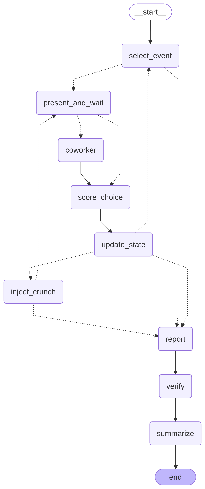
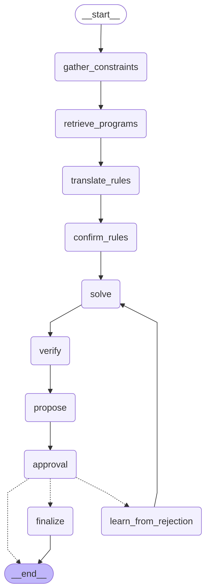
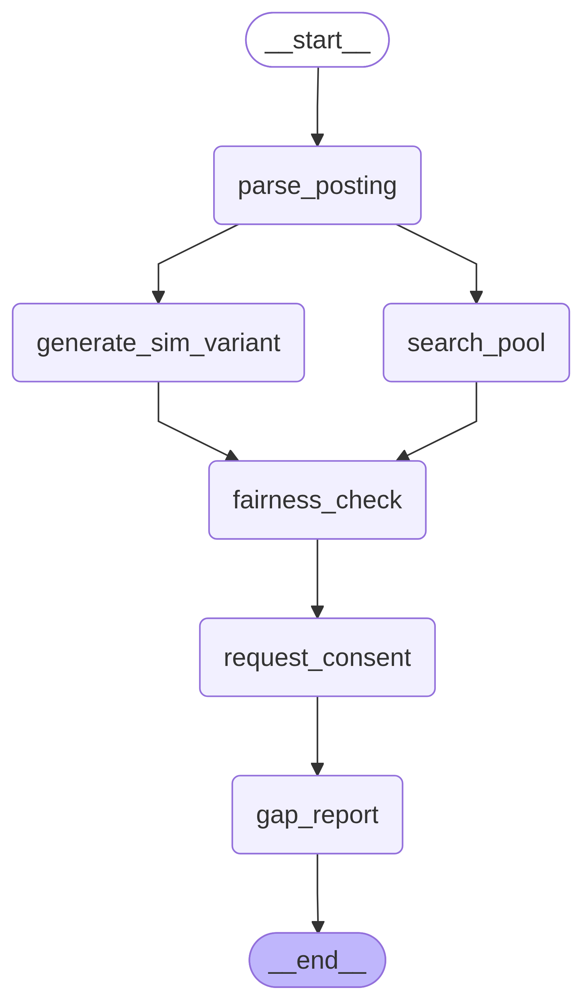
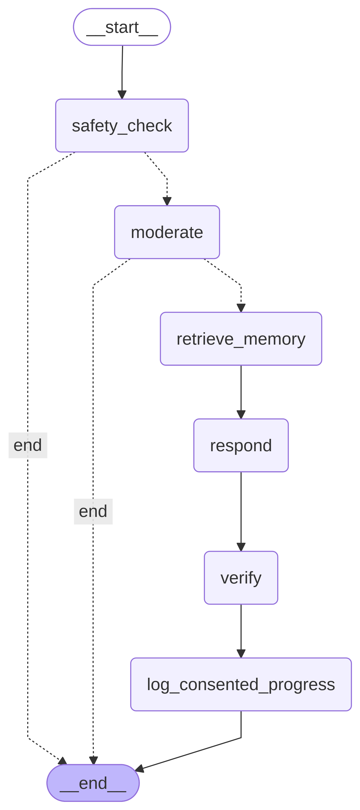

# Foothold architecture

The browser runs a Next.js 16 app (a static export in production). It talks to a FastAPI server over JSON and Server-Sent Events (SSE). Each AI feature on the server is a compiled **LangGraph** graph with a checkpointer: SQLite at `api/.runtime/checkpoints.db`, shared through `foothold.checkpoint.get_checkpointer()`. Each graph run streams `node_start` / `node_end` / `interrupt` / `done` events to the page's "Behind the scenes" trace panel (CONTRACTS section 6).

The images below come from LangGraph itself, not hand-drawn. Each one is `graph.get_graph(xray=True)` rendered with Mermaid; LangGraph Studio and LangSmith draw the same structure. To regenerate them, run `$FOOTHOLD_PY scripts/export_graph_images.py`, which writes `docs/images/langgraph-<name>.mmd` and `.png` at 1600 px wide. In the images, solid arrows are fixed edges and dashed arrows are conditional routes.

## 1. Sim graph (`api/foothold/graphs/sim.py`)

- `select_event`: the adaptive selector (`foothold/selector.py`) keeps a Bayesian posterior over the 8 careers and picks the next workday moment with the highest expected information gain. It stops when confidence reaches 0.8 or after 20 events.
- `present_and_wait`: a **human interrupt**. The graph pauses with the event and its choices (the hidden trait deltas are not sent) and resumes when the learner picks 1, 2 or 3.
- `fan_out` → `coworker`: three LangGraph `Send`s, so the **three fictional AI coworkers react in parallel**. Each one is an LLM call with a deterministic mock fallback.
- `score_choice` → `update_state`: applies the trait deltas, updates the stats and coworker moods. It may route to `inject_crunch` (a pressure event).
- `report` → `verify` → `summarize`: builds the 21-trait profile, gets the top careers from the MLP (`career_fit.py`) and the local wage, then checks every numeric claim in the LLM summary against the data (`verifier.py`). Claims that don't match are dropped, and unverifiable ones are flagged.

## 2. Pathway graph (`api/foothold/graphs/pathway.py`)

- `gather_constraints` → `retrieve_programs` → `translate_rules`: the LLM turns plain-English limits ("no classes before 9am, weekends off") into structured rules. Its output is a validated Pydantic model.
- `confirm_rules`: **human interrupt**. The learner confirms or edits the rules Foothold read before anything is solved.
- `solve`: OR-Tools CP-SAT plans each route type (0.8 s time limit), with a greedy baseline beside it. `verify` re-checks the plan, and `propose` presents it.
- `approval`: **human interrupt**. If the learner approves, `finalize` writes the steps to the board. If they reject, `learn_from_rejection` turns the reason ("too long") into a new constraint and loops back to `solve`.

## 3. Employer graph (`api/foothold/graphs/employer.py`)

- `parse_posting`: posting text is untrusted. It is sanitised, wrapped as `<untrusted kind="posting">` and parsed into a skills profile that must use skills from `skills.json`.
- `search_pool` and `generate_sim_variant` run in parallel. One ranks blind cards (0.7 demonstrated skills + 0.3 recommender score, and the group label is never used). The other drafts a sim variant for the role.
- `fairness_check`: runs a four-fifths rule audit on the shortlist across synthetic groups (minimum group size 5).
- `request_consent`: **human interrupt**. The employer picks who to contact. Each pick creates a consent request, and no contact details are shown.
- `gap_report`: aggregates skill demand across postings, again with a minimum group size of 5.

## 4. Coach graph (`api/foothold/graphs/coach.py`)

- `safety_check`: crisis language ends the run here with the verified 988 message ("Call or text 988...", plus "If you're in immediate danger, call 911"). The LLM never handles a crisis.
- `moderate` → `retrieve_memory` (short-term, in-process: 6 turns, 2 h TTL, contact details redacted) → `respond` (listening mode or EQ practice) → `verify`. The verify step strips diagnoses, medication or legal advice, confidentiality promises and "as your therapist" framing. Then `log_consented_progress` runs.
- No checkpointer and no interrupts: coach conversations are not persisted to disk.

## Per-tab sessions

- Real sign-in (`POST /api/auth/login`). The server returns an HMAC-SHA256-signed token (secret `AUTH_SECRET`, 12 h expiry). Passwords are hashed with stdlib scrypt in the SQLite `accounts` table, which is seeded at startup.
- The web keeps the token in **`sessionStorage`**, not cookies or localStorage. That way each browser tab can be signed into a different account (Luis, Tri-Valley Freight, Maya, Dev) without overwriting the others, and a reload keeps the session.
- Every endpoint that acts for a user takes the identity from the token, never from the request body (`current_account`, `require_kind("learner"|"employer")`).

## Consent model

1. Employers only ever see **blind cards**: demonstrated skills, sim bands and availability. They never see a name, contact details or any group label.
2. A consent request carries the employer identity from the token, plus a message and the posting.
3. Only the learner who owns the card can accept or decline it, in `/inbox`. The inbox polls about every 4 s, so the request shows up live in that learner's tab.
4. On **Accept and share**, contact details are revealed only to the employer whose request was accepted. Declined or pending requests reveal nothing.
5. The gap report and fairness audit only report groups with at least 5 people.

## LLM layer (`api/foothold/llm.py`)

- `llm.structured(...)` and `llm.text(...)` call the OpenAI Responses API (`OPENAI_MODEL=gpt-6-luna`, fallback `gpt-5.6-luna`, reasoning effort `low`). Neither temperature nor top_p is sent.
- **Cache**: responses only (never prompts) go in `api/cache/llm/<task>/<sha256>.json`. With `DEMO_MODE=1`, only the cache is used, and a cache miss falls back to the mock. This protects the demo's golden path from rate limits and network problems.
- **Mock**: every call site supplies a deterministic mock built from structured data, so the whole app runs offline (`LLM_MODE=mock`). Any OpenAI error or 20 s timeout falls back to the mock, and only the error class is logged.
- LLM output that drives logic is validated against Pydantic schemas and vocabularies. Untrusted text is always wrapped as data, never instructions.

## Data and provenance

- `data/processed/*.json` is built by scripts in `data/`. Every record carries `status` (REAL / SAMPLE / SYNTHETIC / FICTIONAL) and a `source_id` that points into `data/SOURCES.md` (generated, includes retrieval dates and URLs).
- REAL: O*NET 31.0 (CC BY 4.0; the 21 work styles converted to 0..1 percentile ranks across 891 occupations), CA EDD OEWS 2026 Q1 wages, CA EDD projections, college fee pages and verified course listings.
- SAMPLE: program schedules and part of the skill taxonomy. These are shown with a "verify" link.
- SYNTHETIC: all ML training and evaluation data and the talent pool. FICTIONAL: all people, employers and circles.
- Storage: SQLite holds accounts and checkpoints. Supabase Postgres (optional, `DB_BACKEND=auto`) mirrors consent requests, postings, circle posts, the progress log and the board. RLS is enabled with no anon policies, except `public_config`, which anon can read so the static site can find the current API URL.
